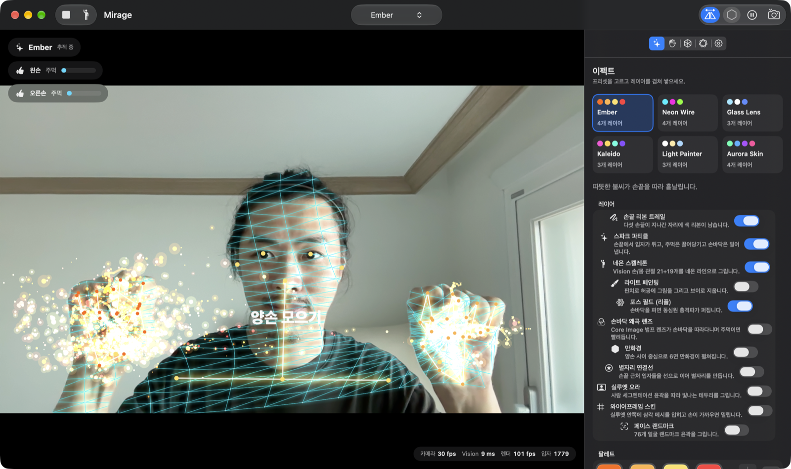
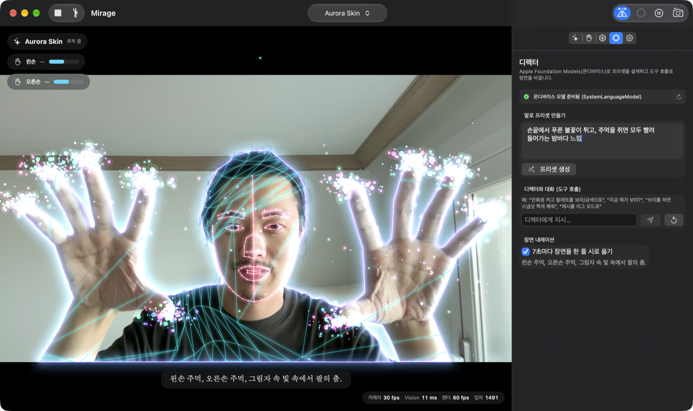
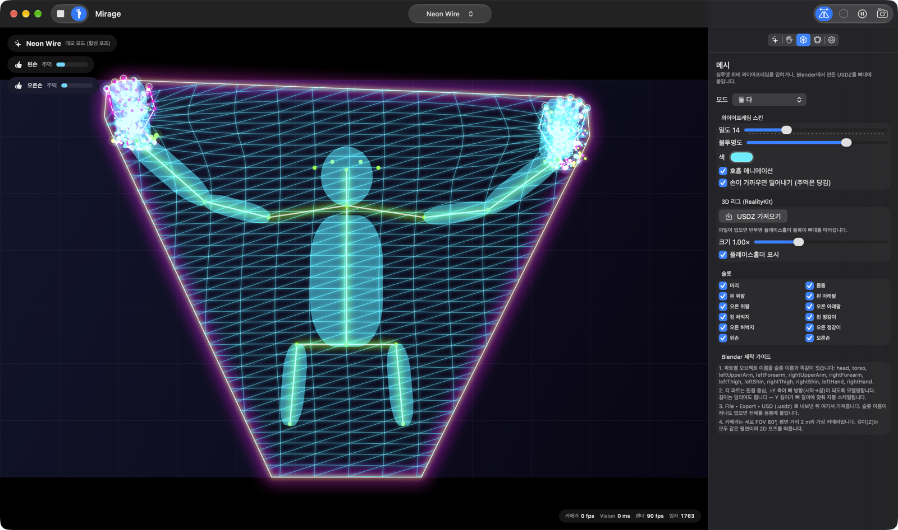
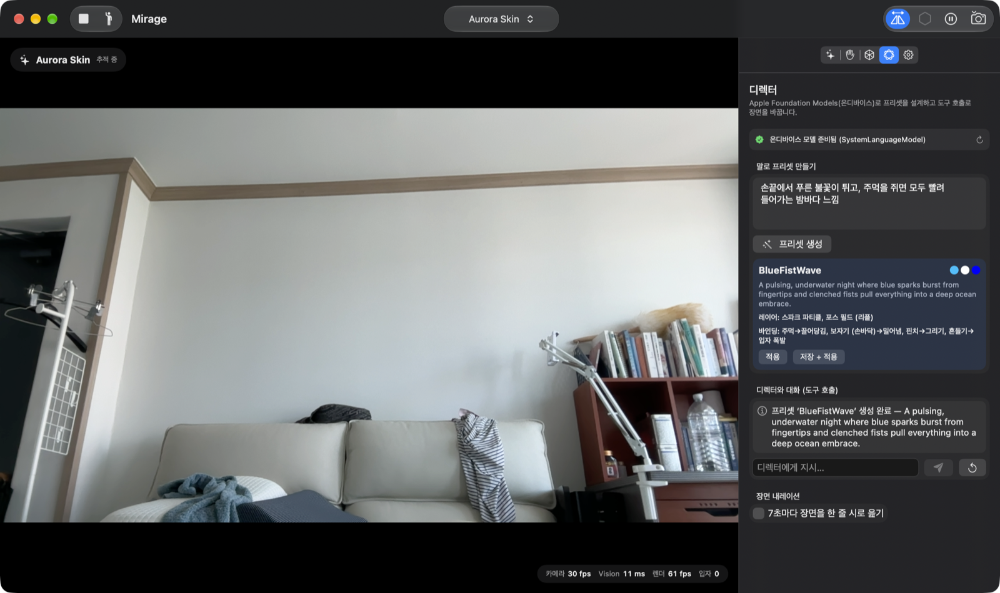
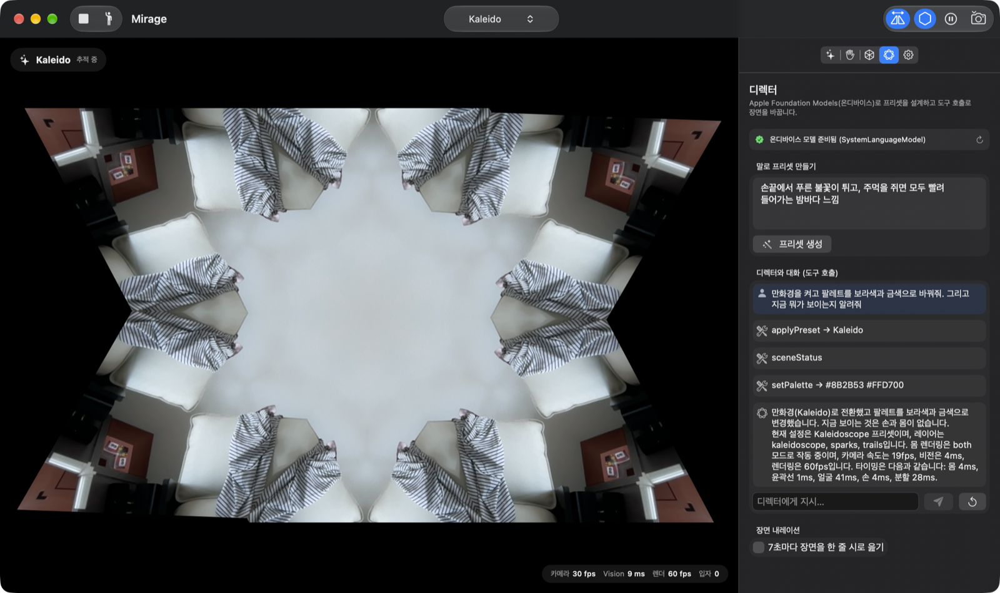
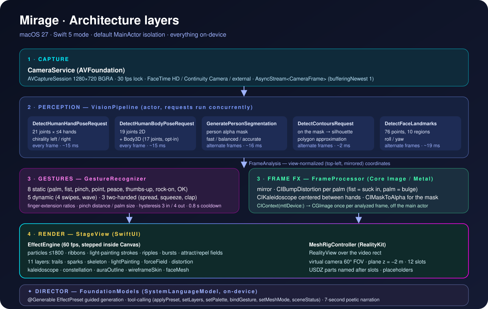

# Mirage — 손끝이 보이는 거울

> **Your hands, made visible.**
> MacBook Air(M4)의 카메라 하나로 손가락 21개 관절·몸 19개 관절·사람 실루엣·얼굴 76점을 실시간으로 읽고,
> 제스처에 반응하는 시각 이펙트를 겹쳐 그리며, 내 몸 위에 와이어프레임 또는 Blender에서 만든 USDZ 메시를 입히는 macOS 앱입니다.
> Apple **Vision · Core Image · RealityKit · FoundationModels**만 사용하고, 영상은 단 한 프레임도 Mac을 떠나지 않습니다.



| | |
|---|---|
| **플랫폼** | macOS 27 (Apple Silicon), Xcode 27, Swift 5 언어 모드 + 기본 MainActor 격리 |
| **프레임워크** | AVFoundation · Vision (Swift API) · Core Image/Metal · SwiftUI Canvas · RealityKit RealityView · FoundationModels |
| **외부 의존성** | 없음 (Swift Package 0개) |
| **라이선스** | [Apache-2.0](LICENSE) |

---

## 무엇을 할 수 있나

### 1. 손가락과 몸을 알아봅니다 (Vision, 전부 온디바이스)

| Vision 요청 | 얻는 것 | 주기 |
|---|---|---|
| `DetectHumanHandPoseRequest` | 손 최대 4개 × 21 관절 + 왼/오른손 구분 | 매 프레임 |
| `DetectHumanBodyPoseRequest` | 몸 19 관절 (2D) | 매 프레임 |
| `DetectHumanBodyPose3DRequest` | 17 관절 카메라 좌표(m) + 추정 신장 | 옵션, 2프레임마다 |
| `GeneratePersonSegmentationRequest` | 사람 알파 마스크 (fast/balanced/accurate) | 2프레임마다 (캐시) |
| `DetectContoursRequest` | 마스크 → 실루엣 폴리곤 | 2프레임마다 |
| `DetectFaceLandmarksRequest` | 얼굴 76점·10개 영역, roll/yaw | 2프레임마다 |

다섯 요청은 `actor VisionPipeline` 안에서 `async let`으로 **동시에** 실행되고, 결과는 모두 “뷰 정규화 좌표(좌상단 원점, 거울 반영)”로 변환된 `FrameAnalysis` 하나로 모입니다. 그 뒤로는 어떤 코드도 좌표 뒤집기를 신경 쓰지 않습니다.

### 2. 16가지 제스처

| 정적 (한 손) | 동적 (한 손) | 양손 |
|---|---|---|
| 보자기, 주먹, 핀치, 포인팅, 브이, 엄지척, 락온 🤘, OK 👌 | 스와이프 ← → ↑ ↓, 흔들기 | 벌리기, 모으기, 박수 |

손가락 펼침 비율·엄지-검지 거리·손바닥 크기로 분류하고, **3프레임 유지 → 발동 / 4프레임 사라짐 → 해제** 히스테리시스와 0.8초 쿨다운으로 떨림을 막습니다. 모든 제스처는 프리셋 안에서 **동작(action)** 에 바인딩됩니다: 입자 폭발, 끌어당김, 밀어냄, 그리기, 캔버스 지우기, 팔레트 전환, 다음 프리셋, 만화경 토글, 메시 토글, 프레임 정지, 스냅샷.

### 3. 11개 시각 레이어, 6개 내장 프리셋

| 레이어 | 설명 |
|---|---|
| 손끝 리본 트레일 | 다섯 손끝이 지나간 자리에 색 리본 |
| 스파크 파티클 | 손끝에서 입자 방출, 주먹은 끌어당기고 손바닥은 밀어냄 (최대 1,800개) |
| 네온 스켈레톤 | 손 21 + 몸 19 관절을 글로우 라인으로 |
| 라이트 페인팅 | 핀치로 허공에 그리고, 바인딩된 제스처로 지움 |
| 포스 필드 | 손바닥을 펴고 있으면 0.5초마다 충격파 링 |
| 손바닥 왜곡 렌즈 | `CIBumpDistortion`이 손바닥을 따라다님 — 주먹이면 빨려듦 |
| 만화경 | `CIKaleidoscope` 6면, 양손 사이가 중심 |
| 별자리 연결선 | 손끝 근처 입자들을 선으로 연결 |
| 실루엣 오라 | 세그멘테이션 윤곽을 따라 색이 흐르는 글로우 테두리 |
| 와이어프레임 스킨 | 실루엣 안쪽에만 삼각 메시 — 호흡하고, 손이 다가오면 밀리고, 주먹이면 당겨짐 |
| 페이스 랜드마크 | 얼굴 윤곽·눈·눈썹·코·입 76점 |

프리셋: **Ember · Neon Wire · Glass Lens · Kaleido · Light Painter · Aurora Skin** (+ 사용자 저장 프리셋).



### 4. 내 몸에 메시 입히기 — 두 가지 방식

**A. 와이어프레임 스킨** (SwiftUI Canvas) — 세그멘테이션 마스크를 `clipToLayer`로 써서 몸 픽셀에만 삼각 그리드를 그립니다. 밀도·색·불투명도·호흡·손 밀어내기를 조절할 수 있습니다.

**B. USDZ 리그** (RealityKit `RealityView`) — 비디오 영역 위에 투명한 RealityKit 씬을 겹치고, Vision 몸 관절로 정의한 **12개 뼈 슬롯**에 메시 파트를 붙입니다. 파일을 넣기 전에는 반투명 플레이스홀더 블록이 뼈대를 따라갑니다.



#### Blender에서 메시를 만들어 입히는 방법

1. 파트별 오브젝트 이름을 슬롯 이름과 똑같이 짓습니다(대소문자·밑줄 무시):
   `head, torso, leftUpperArm, leftForearm, rightUpperArm, rightForearm, leftThigh, leftShin, rightThigh, rightShin, leftHand, rightHand`
2. 각 파트는 **원점 중심, +Y 축이 뼈 방향(시작 → 끝)** 이 되도록 모델링합니다. 길이는 임의여도 됩니다 — Y 길이가 감지된 뼈 길이에 맞춰 자동 스케일됩니다.
3. File ▸ Export ▸ **Universal Scene Description (.usdz)** 로 내보내고, 앱의 **메시 ▸ USDZ 가져오기** 로 불러옵니다. 보안 범위 북마크로 저장되어 다음 실행에도 유지됩니다.
4. 슬롯 이름이 하나도 없으면 전체 모델을 몸통 슬롯에 붙입니다(신장 ≈ 몸통 길이 × 2.4).
5. 가상 카메라는 세로 FOV 60°, 파트는 모두 z = −2 m 평면에 놓입니다(2D 포즈 추종). 자세한 수식은 [메시 다이어그램](Docs/diagrams/mesh-rig.svg)을 보세요.

### 5. 디렉터 — Apple Foundation Models

온디바이스 `SystemLanguageModel`로 세 가지를 합니다.

| 기능 | 구현 |
|---|---|
| **말로 프리셋 만들기** | `@Generable struct EffectPreset`을 `respond(generating:)`로 생성 — 레이어·팔레트·강도·제스처 바인딩이 항상 유효한 타입으로 돌아옵니다 |
| **디렉터와 대화** | `Tool` 6종: `applyPreset`, `setLayers`, `setPalette`, `bindGesture`, `setMeshMode`, `sceneStatus`. “만화경 켜고 팔레트 보라/금색으로, 지금 뭐 보여?” 한 문장에 도구 세 개가 연달아 호출됩니다 |
| **장면 내레이션** | 7초마다 Vision 결과 요약을 넣어 한 줄 시를 받아 HUD에 띄웁니다 |




---

## 실측 (MacBook Air 15" M3 · Mac15,13 · 24 GB, macOS 27.0.1, FaceTime HD 1280×720)

| 항목 | 값 |
|---|---|
| Vision 합계 (손+몸 매 프레임, 무거운 요청 격프레임) | 9–35 ms (평균 ≈ 19 ms, 첫 1초 워밍업 ≈ 60 ms) |
| 손 포즈 / 몸 포즈 / 세그멘테이션(균형) / 얼굴 / 윤곽 | ≈ 15 / 15 / 16 / 19 / 2 ms |
| 분석 프레임률 (사람이 있을 때) | 11–21 fps |
| 분석 프레임률 (빈 방) | 30 fps (카메라 상한) |
| 렌더 (SwiftUI Canvas, 입자 ~1,000개) | 56–117 fps |
| 프리셋 생성 (Foundation Models) | ≈ 8–12 s |
| 도구 호출 대화 (3개 도구) | ≈ 12–15 s |

측정은 `Docs/screenshots` 의 실제 캡처에서 읽은 HUD 수치입니다.

---

## 빠른 시작

```bash
git clone https://github.com/<you>/mirage.git
open "mirage/Untitled Project.xcodeproj"
```

1. 대상 **My Mac** 선택 → ⌘R. 첫 실행 때 카메라 권한을 허용하세요(샌드박스 + `com.apple.security.device.camera`).
2. 카메라 앞에서 손을 펴 보세요. 상단 툴바에서 프리셋을 바꾸거나, 우측 **이펙트 / 제스처 / 메시 / 디렉터 / 설정** 탭을 사용합니다.
3. Apple Intelligence가 켜져 있어야 디렉터 탭이 동작합니다(아니면 사유가 표시됩니다).
4. 카메라가 없거나 혼자 테스트할 때는 툴바의 **데모** 토글(합성 포즈)을 켜세요.

### 키보드 · 실행 인자

| 단축키 | 동작 |
|---|---|
| ⌘] | 다음 프리셋 |
| ⌘K / ⇧⌘K | 라이트 페인팅 지우기 / 모든 입자 지우기 |
| ⌘Space | 프레임 정지·재개 (추적은 계속) |
| ⌘S | 스냅샷 PNG 저장 (오버레이 포함, 2×) |
| ⇧⌘H | HUD 토글 |

디버그/자동화용 실행 인자: `-demo`, `-tab effects|gestures|mesh|director|settings`, `-preset "Neon Wire"`, `-mesh off|wireframe|rigged|both`, `-kaleido`, `-narrate`, `-direct "<프리셋 설명>"`, `-say "<디렉터 지시>"`.

---

## 아키텍처



```
MyApp/
├─ MyApp.swift                  @main MirageApp, 메뉴/단축키
├─ ContentView.swift            스테이지 + 사이드 패널 + 툴바
├─ Core/
│  ├─ Models.swift              TrackedPoint·HandSnapshot·BodySnapshot·FrameAnalysis·GestureKind·EffectPreset(@Generable)·MeshSlot…
│  ├─ CameraService.swift       AVCaptureSession → AsyncStream<CameraFrame> (bufferingNewest 1)
│  ├─ VisionPipeline.swift      actor; 5개 Vision 요청 동시 실행, 격프레임 캐시, 좌표 변환
│  ├─ GestureRecognizer.swift   특징 추출 → 분류 → 히스테리시스 → 동적/양손 제스처
│  ├─ FrameProcessor.swift      Core Image: 거울, 범프 렌즈, 만화경, 마스크→알파
│  ├─ EffectEngine.swift        입자·리본·스트로크·리플 시뮬레이션 (Canvas 안에서 step)
│  ├─ MeshRig.swift             RealityKit 리그: 가상 카메라, 12 슬롯, USDZ 정규화, 스무딩
│  ├─ EffectDirector.swift      FoundationModels: 프리셋 생성·도구 호출·내레이션
│  └─ DemoPoseSource.swift      합성 손/몸/실루엣 (카메라 없이 데모)
└─ App/
   ├─ AppModel.swift            @Observable 오케스트레이터, 설정 영속화, 백그라운드 루프
   ├─ StageView.swift           TimelineView+Canvas 렌더러, HUD, 스냅샷
   └─ SidePanels.swift          이펙트·제스처·메시·디렉터·설정 패널
```

더 많은 다이어그램: [프레임 파이프라인·동시성](Docs/diagrams/frame-pipeline.svg) · [제스처 상태 기계](Docs/diagrams/gesture-state-machine.svg) · [메시 리그](Docs/diagrams/mesh-rig.svg) · [디렉터 시퀀스](Docs/diagrams/director-tools.svg)

문서: [Tech PRD](Docs/TechPRD.md) · [Tasks](Docs/Tasks.md)

---

## 설계 메모 (왜 이렇게 했나)

- **좌표는 한 번만 변환합니다.** Vision의 좌하단 정규 좌표를 파이프라인 출구에서 뷰 좌표로 바꾸고, 왼손/오른손(chirality)은 거울 처리 전 이미지에서 읽어 실제 손과 일치시킵니다.
- **무거운 Vision 요청은 격프레임.** 세그멘테이션·윤곽·얼굴은 2프레임마다 돌리고 캐시를 재사용합니다. 손·몸은 매 프레임이라 제스처 반응성은 유지됩니다.
- **카메라→Vision→Core Image 루프는 메인 액터 밖에서.** 60 fps Canvas가 메인 스레드를 점유해도 분석이 굶지 않도록 `Task.detached`로 돌리고, 결과 publish만 메인으로 넘깁니다(8 fps → 15–21 fps).
- **마스크로 클리핑.** `GraphicsContext.clipToLayer`에 마스크 이미지를 그리면 몸 픽셀에만 메시가 보입니다. 별도 셰이더 없이 SwiftUI만으로 끝납니다.
- **RealityKit 가상 카메라 수식으로 2D↔3D 정렬.** FOV와 평면 거리를 고정하면 정규 좌표 → 월드 좌표가 선형식 하나로 끝나므로, 어떤 USDZ든 뼈 길이에 맞춰 붙일 수 있습니다.
- **FoundationModels는 ‘구조’를 만들 때 씁니다.** 프리셋은 `@Generable`로 항상 유효한 타입이 나오고, 장면 조작은 Tool 호출로 앱 상태를 직접 바꿉니다. 자유 텍스트는 내레이션에서만.

## 알려진 한계 · 다음 단계

- 리그는 2D 포즈를 따르므로 파트가 한 평면에 놓입니다. `DetectHumanBodyPose3DRequest`(이미 수집 중)로 깊이·회전을 입히는 것이 다음 단계입니다.
- 분석 fps는 11–21 fps 수준입니다. 세그멘테이션 `fast` 모드, 입력 다운스케일, 손 2개 제한으로 더 올릴 수 있습니다.
- Swift Testing 타깃은 아직 없습니다(`Docs/Tasks.md` 참고).
- 메시 파일은 USDZ/USDC/USDA/.reality만 지원합니다. OBJ/FBX는 Blender에서 USDZ로 내보내세요.

---

## English summary

**Mirage** is a macOS 27 app that turns the MacBook camera into a gesture-reactive mirror. Apple Vision tracks 21 hand joints per hand (with chirality), 19 body joints, a person segmentation mask (plus contours), and 76 face landmarks — all concurrently, all on-device. A gesture recognizer with hysteresis maps 16 gestures (8 static, 5 dynamic, 3 two-handed) to actions in a preset. Eleven SwiftUI-Canvas / Core Image effect layers (fingertip ribbons, sparks with attract/repel fields, neon skeleton, light painting, ripples, palm lens distortion, kaleidoscope, constellations, silhouette aura, wireframe skin clipped by the person mask, face mesh) are stacked by six built-in presets. The body can also wear a Blender-authored USDZ: a transparent RealityKit `RealityView` with a virtual camera attaches named parts to 12 bone slots derived from the pose. An on-device Foundation Models “director” generates typed presets via `@Generable` guided generation, controls the scene through six tools, and narrates the scene every few seconds. No third-party dependencies. Apache-2.0.

---

Apache License 2.0 — see [LICENSE](LICENSE) and [NOTICE](NOTICE).
